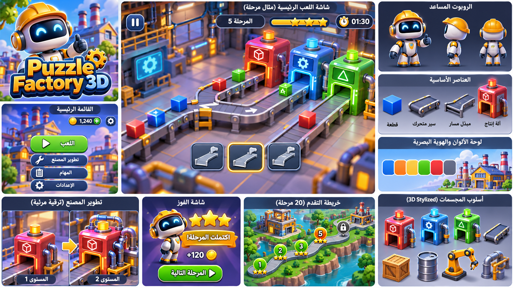

# Puzzle Factory 3D — Visual Bible v1.0

[المصدر المعتمد](https://docs.google.com/document/d/108j9ACEAnhsMRJ-_g-U6DyF33XhbnlSxo79I5PUtBHw/edit)

الحالة: مرجع بصري معتمد في المحادثة، ويجب إرفاق الصورة الأصلية داخل المشروع قبل التنفيذ.

الاتجاه الفني: Stylized 3D مصنع كرتوني غني، حواف ناعمة، خامات متقنة، ألوان واضحة، إضاءة وظلال خفيفة مناسبة لأجهزة Android المتوسطة. تجنب المجسمات البدائية كأصول نهائية والواقعية الثقيلة.

المشهد: سيور نقل متحركة، مفترقات تفاعلية، آلات فرز ملونة، قطع بأشكال ورموز تميّزها إلى جانب اللون، مساعد روبوت صغير غير معيق للمسارات.

الكاميرا: مائلة وثابتة غالبًا، مع تقريب محدود عند النجاح. واجهة Portrait واضحة قابلة للتحكم بيد واحدة، وأزرار كبيرة وهوية بصرية متسقة.

الحركة والصوت: حركة سلسة، مؤثرات أصلية خفيفة عند الفرز الصحيح والخاطئ، احتفال قصير، اهتزاز اختياري.

تجربة البداية المقترحة: 0–15 ثانية توجيه قطعة بمفترق؛ 15–35 ثانية تصنيع ناجح ومكافأة؛ 35–60 ثانية ترقية مرئية بإضافة ذراع روبوت.

معيار القبول: مراجعة صور وفيديو من Unity مقابل المرجع المعتمد؛ لا يكفي نجاح APK. أي قياسات دقيقة أو ألوان HEX أو أبعاد مجسمات تحتاج استخراجًا ومراجعة من الصورة قبل تثبيتها.

تذكر النسخة الأصلية من الوثيقة أن الصورة لم تكن مرفوعة وقت إعدادها. أُرفقت الآن [صورة PNG الأصلية](../assets/reference/Puzzle-Factory-3D-Visual-Reference.png) من [ملف Drive المعتمد](https://drive.google.com/file/d/1CzafUuzYD895upUU5ucZokEXIIKHGrAu/view).

